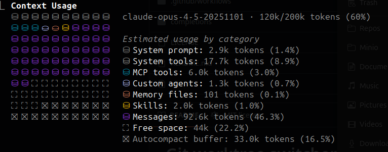

Разберем на примере Claude Code важные функции при работе с агентскими системами.

## Работаем с сессиями

Сессия - основной юнит работы в CC. Каждый раз, когда мы хотим решить какую-то новую задачку, мы создаём новую сессию, в контекст которой загружаются:

- Системный промпт и инструменты
- CLAUDE.md и правила
- Описания скиллов
- Описания включенных инструментов MCP
- Описание кастомных субагентов
- Если сессия не новая, то предыдущие сообщения

Важные команды для работы с сессиями:

- /rewind - откатиться на какой-то шаг разговора
- /resume - продолжить одну из прошлых сессий
- /branch - ответвить разговор (создаётся копия текущей сессии с новым айдишником)
- /fork - отправить копию разговора работать в фоне, а самому продолжить здесь
- /rename - дать удобное название сессии вместо автоматического
- /compact - можно вручную триггернуть сжатие истории сессии. Необходимо при длинных сессиях, так как контекст моделей ограничен 

Авто-сжатие, кстати, постоянно теряет кучу важных деталей (например, какой скрипт с какими параметрами мы сейчас используем для дебаггинга), так что лучше такие штуки добавлять в md-файл со спецификацией задачи и сразу его прокидывать в контекст после сжатия. Если детали всё-таки потерялись, можно попросить агента найти их в исходной сессии - история целиком лежит в jsonl-файле в `~/.claude/projects/`.

Для продолжения сессий можно также запускать такие команды в терминале:

- `claude --continue` — последняя
- `claude --resume` — список для выбора
- `claude --continue --fork-session` — последняя сессия клонируется

Важно - по умолчанию сессии хранятся **30 дней** после последнего изменения. Это можно изменить в конфиге (настройка cleanupPeriodDays).

Очень удобная тулза для поиска сессий во всех проектах сразу: [Coversation Searchf](https://github.com/akatz-ai/cc-conversation-search).

Чтоб посмотреть, что занимает контекст - наберите /context. Неиспользуемые плагины лучше отключать. Скиллы и инструменты MCP подгружаются лениво - в контексте сначала только названия и краткие описания.

Полезные хоткеи:

- CTRL + U - стереть всю строчку
- Shift + Enter - новая строчка (сначала нужно запустить /terminal-setup). Если не работает, то печатаем бэкслэш \ и нажимаем Enter

## Режимы работы

У CC несколько режимов, основные переключаются по **Shift+Tab**:

- **Дефолтный** - спрашивает пользователя перед каждым действием в рамках текущих настроенных [разрешений](https://code.claude.com/docs/en/iam#access-control-and-permissions).
    - /permissions - команда для установки разрешенных действий.
    - Ещё можно покопаться в файле [настроек](https://code.claude.com/docs/en/settings) или команде /config.
- **Авто-аксепт правок** - сам подтверждает изменения файлов в рабочей папке и простые команды вроде mkdir или mv, остальное спрашивает.
- **Режим планирования** - обсуждаем задачу и создаём маркдаун с описанием, пока не делаем никаких изменений.
- **Auto mode** - отдельная модель решает, безопасно ли запускать команду. Сейчас он включён при старте по умолчанию.
- **YOLO** (`--dangerously-skip-permissions`) - делает всё, что явно не запрещено. В цикл Shift+Tab попадает, только если его явно включить.

Подробнее про auto mode и YOLO - в разделе [Безопасность](/company/security/#продвинутые-режимы-работы).

Ещё можно поменять стиль ответов через команду /output-style:

- Дефолтный
- Проактивный - сразу берётся за реализацию и сам принимает рутинные решения вместо вопросов. Но перед удалением данных или изменением общих систем всё равно спрашивает
- Краткий - сразу сообщает результат, без вступлений и итогов, на простые вопросы отвечает в пару предложений
- Объясняющий - добавляет короткие пояснения, почему принято то или иное решение
- Обучающий - в местах важных решений оставляет `TODO(human)`, и этот кусок кода вы пишете сами
